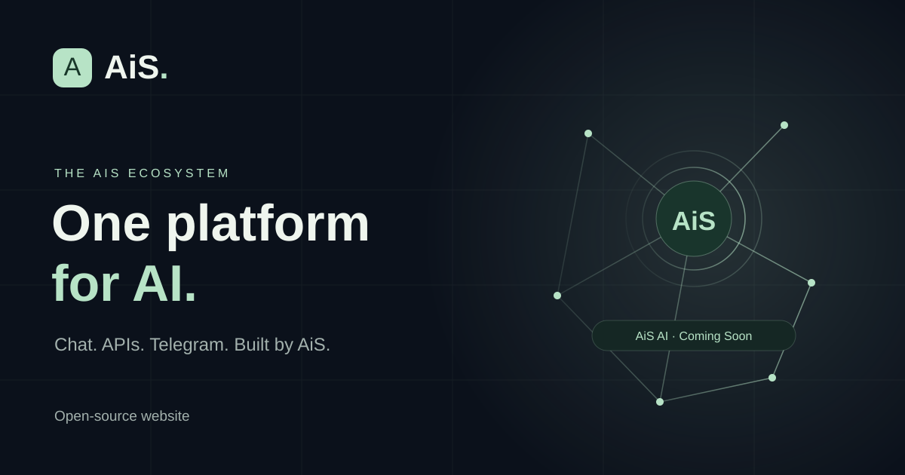

# AiS Website

**English** · [Русский](#ais-website-1)

An open-source copy of the AiS Platform public website. It is a static product
overview and developer landing page built with React, TypeScript, Vite, and CSS.
It does not include or call an AiS backend, chat service, authentication service,
or model provider.

## Features

- Responsive product pages and navigation.
- English, Russian, and Uzbek (Latin) interface text.
- Six themes, persisted per browser and synchronized between tabs.
- Accessible navigation, theme picker, code tabs, and copy controls.
- Reduced-motion support and decorative architecture diagrams.
- OpenAI-compatible API examples with a configurable public API base URL.
- No analytics, telemetry, runtime API requests, or frontend secrets.



Product screenshots are not included: their redistribution rights were not
established. The Telegram section remains an illustrative product overview.

## Architecture

- `src/App.tsx`: page sections, product cards, architecture, and responsive previews.
- `src/components/`: navigation, API examples, and architecture illustration.
- `src/settings.tsx`: language/theme state, persistence, and translated metadata.
- `src/locales/uz.ts`: Uzbek translations.
- `src/config.ts`: public build-time endpoint and contact configuration.
- `src/styles.css`: design tokens, six themes, responsive layouts, and motion.
- `public/`: original AiS favicon and social-preview artwork.
- `index.html`: document shell and initial theme/language bootstrap.

This repository contains only the website frontend. Self-hosted AiS Backend API,
chat, authentication, and model-provider services are separate deployments.

## Technology

- React 19 and React DOM
- TypeScript 5.9
- Vite 7
- pnpm 12
- DM Sans Variable and Space Grotesk Variable fonts

Dependency and font license details are in
[`THIRD-PARTY-NOTICES.md`](THIRD-PARTY-NOTICES.md).

## Requirements

- Node.js 22.12 or later
- pnpm 12.6.0 (or Corepack with the version in `package.json`)

## Install and develop

```sh
pnpm install --frozen-lockfile
cp .env.example .env.local
pnpm dev
```

Open the local address printed by Vite. `.env.local` is ignored by Git. Vite
reads `VITE_*` values at build time; these values are public in the resulting
browser bundle and must never contain passwords, API keys, tokens, or other
secrets.

## Environment and API configuration

| Variable | Default | Purpose |
| --- | --- | --- |
| `VITE_API_BASE_URL` | `https://api.example.org/v1` | Public OpenAI-compatible API base URL, including its version path |
| `VITE_AUTH_URL` | empty | Optional public sign-in entry URL; takes precedence over the chat URL in Chat links |
| `VITE_CHAT_URL` | empty | Optional public URL for a separately hosted chat application |
| `VITE_TELEGRAM_BOT_URL` | empty | Optional public Telegram bot URL |
| `VITE_SUPPORT_EMAIL` | empty | Optional support contact address |

The default `https://api.example.org/v1` is a placeholder. For local
development behind a same-origin reverse proxy, set
`VITE_API_BASE_URL=/api/v1`. For a separately hosted API, set its absolute URL,
for example `VITE_API_BASE_URL=https://api.example.org/v1`. The site displays
this base URL and uses it in its copyable Python, cURL, and JavaScript examples.
Restart Vite after changing environment values.

The website itself has no sign-in page and makes no authentication requests.
When `VITE_AUTH_URL` is set, Chat links open that public sign-in entry URL;
otherwise they use `VITE_CHAT_URL`. The authentication flow, redirects, and
credential validation remain the responsibility of your self-hosted chat and
backend. The API examples demonstrate bearer-key authentication using a
placeholder. Never expose backend secrets through `VITE_*` variables.

## Build and preview

```sh
pnpm build
pnpm preview
```

The build runs the TypeScript project checks and writes static files to `dist/`.
No automated unit-test or lint script is present; this project includes an
independent GitHub Actions workflow that installs from the frozen lockfile,
audits dependencies, and builds the site.

## Self-hosting and deployment

1. Configure your own backend, API, chat, bot, and support destinations as needed.
2. Set the public `VITE_*` values in your deployment environment before building.
3. Build with `pnpm install --frozen-lockfile && pnpm build`.
4. Serve `dist/` from any static web host. If the API uses `/api/v1`, configure a
   same-origin reverse proxy to your self-hosted backend; otherwise set an
   absolute `VITE_API_BASE_URL`.
5. Apply your own domain, TLS, caching, and static-host routing configuration.

GitHub Actions in this repository only checks and builds the site; it does not
deploy it. There is no AWS Amplify configuration, production remote, production
workflow, or automatic connection to the original AiS production application.
Connect this repository to a deployment provider only after reviewing that
provider's settings independently.

## Screenshots and redistribution

The original site included product screenshots. They have been excluded from
this public copy because permission to redistribute their contents could not
be established. The included social preview and favicon are original AiS
website artwork. Third-party logos, fonts, software, product names, and
trademarks remain subject to their respective owners' terms.

## License

Original website source code is licensed under the MIT License; see
[`LICENSE`](LICENSE). The license does not grant rights to AiS names, logos,
trademarks, or any third-party materials. See
[`THIRD-PARTY-NOTICES.md`](THIRD-PARTY-NOTICES.md) for dependency and font
notices. No claim is made that third-party assets or trademarks are cleared
for uses beyond their applicable licenses and permissions.

---

<a id="ais-website-1"></a>

# AiS Website

**Русский** · [English](#ais-website)

Открытая копия публичного сайта AiS Platform. Это статический обзор продуктов
и страница для разработчиков на React, TypeScript, Vite и CSS. В репозитории
нет серверной части AiS; сайт не обращается к API, чату, службе
аутентификации или провайдерам моделей.

## Возможности

- Адаптивные страницы продуктов и навигация.
- Английский, русский и узбекский (латиница) интерфейс.
- Шесть тем с сохранением настроек в браузере и синхронизацией между вкладками.
- Доступные навигация, выбор темы, вкладки примеров кода и копирование.
- Поддержка уменьшения анимации и декоративные схемы архитектуры.
- Примеры OpenAI-совместимого API с настраиваемым публичным базовым URL.
- Нет аналитики, телеметрии, сетевых запросов при работе сайта и секретов во
  фронтенде.

Скриншоты продуктов не включены: права на их распространение не были
подтверждены. Раздел Telegram сохранён как иллюстративный обзор продукта.

## Архитектура

- `src/App.tsx`: разделы страниц, карточки продуктов, схема архитектуры и
  адаптивные превью.
- `src/components/`: навигация, примеры API и иллюстрация архитектуры.
- `src/settings.tsx`: состояние языка и темы, хранение настроек и переведённые
  метаданные.
- `src/locales/uz.ts`: узбекские переводы.
- `src/config.ts`: публичная конфигурация адресов и контакта на этапе сборки.
- `src/styles.css`: дизайн-токены, шесть тем, адаптивная вёрстка и анимация.
- `public/`: оригинальные фавикон и изображение для превью AiS.
- `index.html`: оболочка документа и начальная настройка темы и языка.

Репозиторий содержит только фронтенд сайта. Серверные API, чат,
аутентификация и провайдеры моделей разворачиваются отдельно.

## Технологии

- React 19 и React DOM
- TypeScript 5.9
- Vite 7
- pnpm 12
- Шрифты DM Sans Variable и Space Grotesk Variable

Сведения о лицензиях зависимостей и шрифтов приведены в
[`THIRD-PARTY-NOTICES.md`](THIRD-PARTY-NOTICES.md).

## Требования

- Node.js 22.12 или новее
- pnpm 12.6.0 (или Corepack с версией из `package.json`)

## Установка и разработка

```sh
pnpm install --frozen-lockfile
cp .env.example .env.local
pnpm dev
```

Откройте локальный адрес, который покажет Vite. Файл `.env.local` исключён из
Git. Vite встраивает значения `VITE_*` в сборку, поэтому они доступны в
браузере и не должны содержать пароли, API-ключи, токены и другие секреты.

## Переменные окружения и настройка API

| Переменная | По умолчанию | Назначение |
| --- | --- | --- |
| `VITE_API_BASE_URL` | `https://api.example.org/v1` | Публичный базовый URL OpenAI-совместимого API, включая версию |
| `VITE_AUTH_URL` | пусто | Необязательный публичный адрес входа; имеет приоритет над адресом чата в ссылках |
| `VITE_CHAT_URL` | пусто | Необязательный публичный адрес отдельно размещённого чата |
| `VITE_TELEGRAM_BOT_URL` | пусто | Необязательный публичный адрес Telegram-бота |
| `VITE_SUPPORT_EMAIL` | пусто | Необязательный адрес службы поддержки |

Значение по умолчанию `https://api.example.org/v1` — это пример. Для локальной
разработки с обратным прокси того же источника задайте
`VITE_API_BASE_URL=/api/v1`. Для отдельного API укажите его полный URL,
например `VITE_API_BASE_URL=https://api.example.org/v1`. Сайт отображает этот
адрес и подставляет его в примеры для Python, cURL и JavaScript. После
изменения переменных перезапустите Vite.

На сайте нет страницы входа, и он не отправляет запросы аутентификации.
Если задан `VITE_AUTH_URL`, ссылки на чат открывают этот публичный адрес
входа; иначе используется `VITE_CHAT_URL`. Поток аутентификации, перенаправления
и проверка учётных данных остаются ответственностью вашего чата и backend.
Примеры API показывают Bearer-аутентификацию с тестовым заполнителем. Не
публикуйте секреты через переменные `VITE_*`.

## Сборка и предпросмотр

```sh
pnpm build
pnpm preview
```

Сборка проверяет проект TypeScript и создаёт статические файлы в `dist/`.
Автоматические модульные тесты и сценарий линтера в проекте отсутствуют.
Независимый GitHub Actions workflow устанавливает зависимости по
зафиксированному lockfile, проверяет их на уязвимости и собирает сайт.

## Самостоятельный хостинг и развёртывание

1. При необходимости настройте собственные backend, API, чат, бот и контактные
   адреса.
2. Перед сборкой задайте публичные значения `VITE_*` в окружении развёртывания.
3. Выполните `pnpm install --frozen-lockfile && pnpm build`.
4. Разместите `dist/` на любом статическом хостинге. Для `/api/v1` настройте
   обратный прокси к собственному серверу; иначе задайте абсолютный
   `VITE_API_BASE_URL`.
5. Самостоятельно настройте домен, TLS, кэширование и маршрутизацию хостинга.

GitHub Actions в этом репозитории только проверяет и собирает сайт; публикации
сборки нет. Здесь отсутствуют конфигурация AWS Amplify, production remote,
production workflow и автоматическая связь с исходным production-приложением
AiS. Подключайте этот репозиторий к провайдеру развёртывания только после
отдельной проверки его настроек.

## Скриншоты и распространение

В исходном сайте были скриншоты продуктов. Они исключены из публичной копии,
поскольку право на распространение их содержимого не подтверждено. Включённые
изображения превью и фавикон — оригинальная графика сайта AiS. Сторонние
логотипы, шрифты, программы, названия продуктов и товарные знаки по-прежнему
подчиняются условиям соответствующих правообладателей.

## Лицензия

Оригинальный исходный код сайта распространяется по лицензии MIT; см.
[`LICENSE`](LICENSE). Лицензия не предоставляет прав на названия, логотипы и
товарные знаки AiS или сторонние материалы. Уведомления о зависимостях и
шрифтах см. в [`THIRD-PARTY-NOTICES.md`](THIRD-PARTY-NOTICES.md). Не
утверждается, что сторонние материалы или товарные знаки разрешены для любого
использования сверх применимых лицензий и разрешений.
